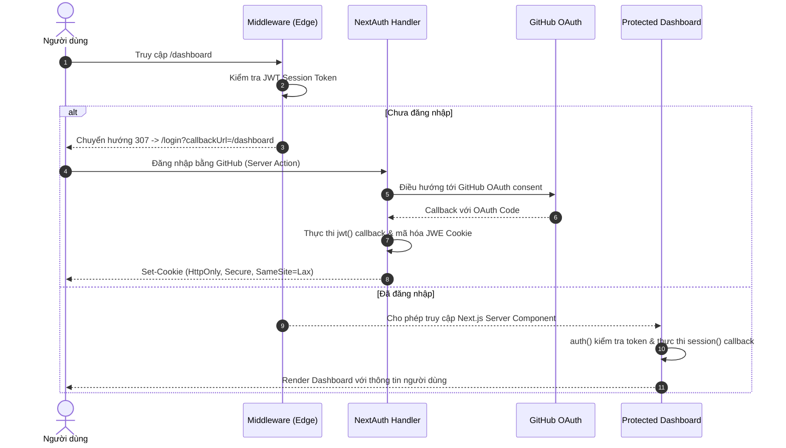

# Next.js 14/15/16 + NextAuth.js (Auth.js v5) JWT Authentication

Dự án triển khai giải pháp xác thực người dùng (**Stateless Authentication**) sử dụng **Next.js App Router**, **NextAuth.js (v5 Beta)** và **JSON Web Token (JWT)** với nhà cung cấp **GitHub OAuth**.

---

## 📑 Mục Lục
1. [Kiến Trúc & Tổng Quan](#-kiến-trúc--tổng-quan)
2. [Cấu Trúc Thư Mục](#-cấu-trúc-thư-mục)
3. [Biến Môi Trường (Environment Variables)](#-biến-môi-trường-environment-variables)
4. [Hướng Dẫn Cài Đặt & Chạy Ứng Dụng](#-hướng-dẫn-cài-đặt--chạy-ứng-dụng)
5. [Các Lệnh Thực Thi (Scripts)](#-các-lệnh-thực-thi-scripts)
6. [Chi Tiết Cấu Hình NextAuth & JWT Callbacks](#-chi-tiết-cấu-hình-nextauth--jwt-callbacks)
7. [Cơ Chế Bảo Vệ Tuyến Đường (Middleware Route Protection)](#-cơ-chế-bảo-vệ-tuyến-đường-middleware-route-protection)
8. [Trang Bảng Điều Khiển Được Bảo Vệ (Protected Dashboard)](#-trang-bảng-điều-khiển-được-bảo-vệ-protected-dashboard)
9. [Báo Cáo Đánh Giá Bảo Mật & Best Practices](#-báo-cáo-đánh-giá-bảo-mật--best-practices)

---

## 🏛️ Kiến Trúc & Tổng Quan

- **Framework:** Next.js (App Router, Server Components & Server Actions)
- **Auth Library:** `next-auth` (v5.0.0-beta / Auth.js)
- **Authentication Strategy:** Stateless JWT Session (Không lưu state session trong database).
- **Identity Provider:** GitHub OAuth 2.0.
- **Route Guard:** Next.js Middleware chạy trên Edge Runtime để chặn truy cập trái phép trước khi request tới Server Components.
- **Strict Typing:** TypeScript Module Augmentation cho Session và JWT payload.



---

## 📂 Cấu Trúc Thư Mục

```text
authentication-jwt-nextauth/
├── app/
│   ├── api/
│   │   └── auth/
│   │       └── [...nextauth]/
│   │           └── route.ts          # NextAuth Route Handler (GET, POST)
│   ├── dashboard/
│   │   └── page.tsx                  # Trang Dashboard được bảo vệ (Server Component)
│   ├── login/
│   │   └── page.tsx                  # Trang Đăng nhập tùy chỉnh
│   ├── globals.css                   # Định kiểu CSS toàn cục
│   ├── layout.tsx                    # Root Layout chuẩn hóa typing
│   └── page.tsx                      # Trang chủ kiểm tra trạng thái xác thực
├── types/
│   └── next-auth.d.ts                # TypeScript Module Augmentation (Session, JWT, User)
├── .env.example                      # Mẫu biến môi trường
├── .env.local                        # Biến môi trường cục bộ (không commit)
├── auth.ts                           # Cấu hình trung tâm NextAuth v5 (providers, callbacks)
├── middleware.ts                     # Middleware chặn các route bảo vệ (/dashboard)
├── next.config.ts                    # Cấu hình Next.js
├── package.json                      # Quản lý dependencies & scripts
├── tsconfig.json                     # Cấu hình TypeScript nghiêm ngặt
└── README.md                         # Tài liệu dự án
```

---

## 🔑 Biến Môi Trường (Environment Variables)

Tạo file `.env.local` ở thư mục gốc của dự án dựa trên `.env.example`:

| Tên biến | Bắt buộc | Mô tả | Giá trị mẫu / Cách lấy |
| :--- | :---: | :--- | :--- |
| `AUTH_SECRET` | **Có** | Secret key dùng để mã hóa và ký các token JWT và Cookie phiên. | Sinh ngẫu nhiên bằng `npx auth secret` hoặc `openssl rand -base64 32` |
| `NEXTAUTH_SECRET` | *Khuyên dùng* | Alias tương thích cho các công cụ NextAuth cũ. | Đặt trùng giá trị với `AUTH_SECRET` |
| `AUTH_URL` | Tùy chọn | URL gốc của ứng dụng (Bắt buộc khi deploy production). | `http://localhost:3000` |
| `AUTH_GITHUB_ID` | **Có** | Client ID của GitHub OAuth App. | Lấy từ GitHub Developer Settings |
| `AUTH_GITHUB_SECRET` | **Có** | Client Secret của GitHub OAuth App. | Lấy từ GitHub Developer Settings |

### 🛠️ Hướng Dẫn Đăng Ký GitHub OAuth App
1. Truy cập **GitHub** → **Settings** → **Developer Settings** → **OAuth Apps** → **New OAuth App**.
2. Điền các trường:
   - **Application name:** `NextAuth JWT App`
   - **Homepage URL:** `http://localhost:3000`
   - **Authorization callback URL:** `http://localhost:3000/api/auth/callback/github`
3. Nhấn **Register application**, sao chép **Client ID** vào `AUTH_GITHUB_ID`.
4. Tạo và sao chép **Client Secret** vào `AUTH_GITHUB_SECRET`.

---

## 🚀 Hướng Dẫn Cài Đặt & Chạy Ứng Dụng

### 1. Clone repository
```bash
git clone https://github.com/n23dcpt043-quan/authentication-jwt-nextauth.git
cd authentication-jwt-nextauth
```

### 2. Cài đặt các gói phụ thuộc
```bash
npm install
```

### 3. Cấu hình file môi trường
Tạo file `.env.local`:
```bash
cp .env.example .env.local
```
Tạo secret ngẫu nhiên:
```bash
npx auth secret
```
Điền `AUTH_GITHUB_ID` và `AUTH_GITHUB_SECRET` từ GitHub vào `.env.local`.

---

## 📜 Các Lệnh Thực Thi (Scripts)

| Lệnh | Môi trường | Chức năng |
| :--- | :--- | :--- |
| `npm run dev` | **Development** | Khởi chạy server phát triển tại `http://localhost:3000` với Turbopack Hot Reload. |
| `npm run build` | **Production Build** | Kiểm tra TypeScript, tối ưu hóa bundle và tạo bản build sản phẩm. |
| `npm start` | **Production Server** | Khởi chạy máy chủ Production từ bản build đã tạo. |
| `npm run lint` | **Code Quality** | Chạy ESLint để quét lỗi cú pháp và tiêu chuẩn mã nguồn. |

---

## ⚙️ Chi Tiết Cấu Hình NextAuth & JWT Callbacks

Cấu hình nằm tại [auth.ts](file:///auth.ts):

```typescript
import NextAuth from "next-auth";
import GitHub from "next-auth/providers/github";

export const { handlers, auth, signIn, signOut } = NextAuth({
  providers: [
    GitHub({
      clientId: process.env.AUTH_GITHUB_ID,
      clientSecret: process.env.AUTH_GITHUB_SECRET,
    }),
  ],
  session: {
    // Sử dụng stateless JWT thay vì database session
    strategy: "jwt",
    maxAge: 30 * 24 * 60 * 60, // 30 ngày
  },
  callbacks: {
    /**
     * 1. jwt callback: Được gọi khi JWT token được tạo hoặc cập nhật.
     * Trích xuất ID và role từ user profile khi đăng nhập lần đầu.
     */
    async jwt({ token, user }) {
      if (user) {
        token.id = user.id;
        token.role = user.role ?? "user";
      }
      return token;
    },

    /**
     * 2. session callback: Được gọi khi client hoặc server gọi auth() / useSession().
     * Gắn ID và role từ token vào session.user để UI sử dụng.
     */
    async session({ session, token }) {
      if (session.user && token) {
        if (token.id) {
          session.user.id = token.id as string;
        }
        if (token.role) {
          session.user.role = token.role as string;
        }
      }
      return session;
    },
  },
  pages: {
    signIn: "/login",
  },
  secret: process.env.AUTH_SECRET || process.env.NEXTAUTH_SECRET,
});
```

### Route Handler: `app/api/auth/[...nextauth]/route.ts`
```typescript
import { handlers } from "@/auth";

export const { GET, POST } = handlers;
```

---

## 🛡️ Cơ Chế Bảo Vệ Tuyến Đường (Middleware Route Protection)

Tệp [middleware.ts](file:///middleware.ts) chặn các request unauthenticated đến `/dashboard`:

```typescript
import { auth } from "@/auth";
import { NextResponse } from "next/server";

export default auth((req) => {
  const { nextUrl } = req;
  const isLoggedIn = !!req.auth;

  const isProtectedPath = nextUrl.pathname.startsWith("/dashboard");
  const isAuthPage = nextUrl.pathname === "/login";

  // 1. Chặn người dùng chưa đăng nhập khi truy cập /dashboard
  if (isProtectedPath && !isLoggedIn) {
    const loginUrl = new URL("/login", nextUrl.origin);
    loginUrl.searchParams.set("callbackUrl", nextUrl.pathname);
    return NextResponse.redirect(loginUrl);
  }

  // 2. Chuyển hướng người dùng đã đăng nhập khỏi trang /login
  if (isAuthPage && isLoggedIn) {
    return NextResponse.redirect(new URL("/dashboard", nextUrl.origin));
  }

  return NextResponse.next();
});

export const config = {
  matcher: [
    "/((?!api/auth|_next/static|_next/image|favicon.ico|.*\\.(?:svg|png|jpg|jpeg|gif|webp)$).*)",
  ],
};
```

---

## 📊 Trang Bảng Điều Khiển Được Bảo Vệ (Protected Dashboard)

Tệp [app/dashboard/page.tsx](file:///app/dashboard/page.tsx) là một **React Server Component**:
- Sử dụng `const session = await auth();` để đọc phiên đăng nhập trực tiếp trên máy chủ.
- Thực hiện **Defense-in-depth**: Kiểm tra lại phiên ở cấp Component đề phòng middleware bị bypass.
- Hiển thị đầy đủ thông tin: Avatar, Họ tên, Email, `user.id`, `user.role` và toàn bộ cấu trúc JSON payload của JWT.
- Cung cấp nút **Đăng xuất** an toàn thông qua **Next.js Server Actions** (`signOut({ redirectTo: "/" })`).

---

## 🔍 Báo Cáo Đánh Giá Bảo Mật & Best Practices

1. **Quản lý Mật Khẩu (Password Handling):**
   - Dự án sử dụng GitHub OAuth 2.0 (uỷ quyền xác thực an toàn, không trực tiếp xử lý hay lưu trữ mật khẩu người dùng).
   - *Khuyến nghị:* Trường hợp mở rộng thêm Credentials Provider (email/password), bắt buộc sử dụng `bcryptjs` hoặc `argon2` với salt rounds $\ge 12$, tuyệt đối không bao giờ lưu trữ mật khẩu dạng plain text hoặc gửi mật khẩu qua JWT token.

2. **Lưu trữ & Bảo Mật JWT (JWT Storage & Transmission):**
   - JWT được Auth.js lưu trữ trong Cookie được mã hóa (JWE) với chuẩn A256GCM.
   - Cookie được thiết lập các cờ bảo mật quan trọng:
     - `HttpOnly`: Ngăn chặn mã độc JavaScript phía client đánh cắp cookie (chống XSS).
     - `SameSite: Lax`: Giảm thiểu rủi ro Cross-Site Request Forgery (CSRF).
     - `Secure`: Bắt buộc truyền tải qua giao thức HTTPS trong môi trường production.
   - **Tối giản Payload:** Token chỉ chứa các định danh thiết yếu (`id`, `name`, `email`, `role`). Không bao giờ đưa thông tin nhạy cảm vào JWT.

3. **Session Management & Next.js 14/15/16 App Router Standards:**
   - Sử dụng `auth()` trong Server Components thay vì các giải pháp client-side polling hoặc waterfalls.
   - Sử dụng Server Actions cho các thao tác đăng nhập / đăng xuất để ngăn ngừa CSRF.
   - Định kiểu nghiêm ngặt (Strict TypeScript Typing) với `types/next-auth.d.ts` để loại bỏ hoàn toàn việc ép kiểu `any`.